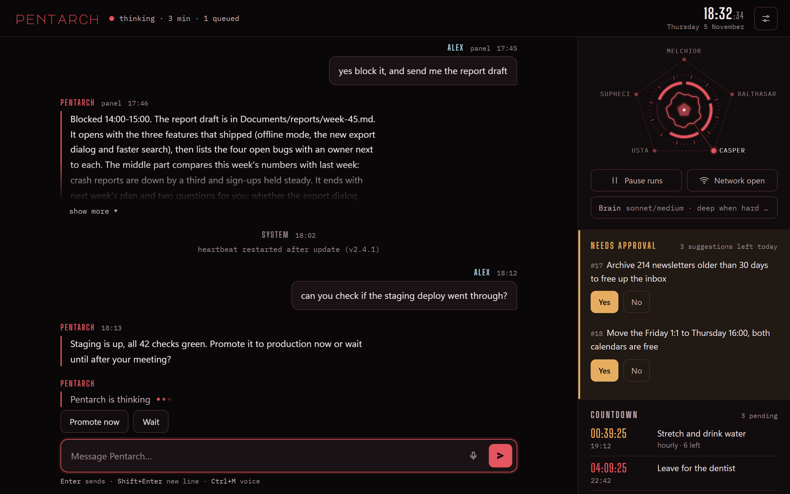

<p align="center"></p>

<h1 align="center">Pentarch</h1>

<p align="center">
A personal assistant that lives on your own computer and talks to you over Telegram.<br>
It runs on the AI agent you already use, remembers what you tell it, works through its own routines all day,<br>
and asks before it does anything you can't take back.
</p>

<p align="center">
<a href="#install">Install</a> ·
<a href="#what-it-does">What it does</a> ·
<a href="#telegram-commands">Commands</a> ·
<a href="#configure">Configure</a> ·
<a href="#safety">Safety</a> ·
<a href="#türkçe">Türkçe</a>
</p>



## Why

Chat apps forget you when the tab closes, and most "agent" projects want a server, a database and a stack of API keys before they say hello. Pentarch is one Python process on your machine. It drives the agent CLI you're already logged in to (Claude Code, Gemini CLI, Codex or OpenCode), keeps everything it knows about you in plain markdown files you can open and edit, and reaches you where you already are: Telegram.

A normal day looks like this. At 08:30 it sends a morning brief: what's due, what you're waiting on, one thing it suggests doing first. You send it a voice note from the bus; it transcribes it locally and files the note. A routine notices a job posting that matches your profile and asks with Yes/No buttons whether to add it to your tracker. In the evening it sums up the day. Overnight it tidies its own memory. None of that sent a message, pushed code or deleted a file on your behalf, because outward actions always wait for your yes.

## How it fits together

```
 you ── Telegram ──┐                       ┌── Claude Code / Gemini CLI / Codex / OpenCode
       (or e-mail, │                       │   (the agent does the thinking and the tool use)
        Discord)   ▼                       │
              app/pentarch.py ─────────────┤
              one process: chat, routines, ├── ~/.pentarch       settings, memory, rules, secrets
              reminders, approvals, panel  ├── your notes folder  markdown wiki, searched with FTS5
                       │                   └── optional API       OpenRouter, Groq, Ollama… for cheap one-shot work
                       ▼
           http://127.0.0.1:47824  (local panel)
```

## What it does

### Talk to it
- **Telegram chat** with text, photos, voice notes and buttons. With Claude Code the chat stays in one long-lived session all day, so replies are quick and the prompt cache stays warm. Hard questions move to a deeper model on their own.
- **Other doors (optional).** E-mail (IMAP in, SMTP out) and a Discord bot go through the same handling as Telegram. Off until you turn them on.
- **Voice.** Voice notes become text on your machine (faster-whisper). It can answer with voice too (edge-tts, or Piper offline). Filler words are dropped from the transcript.
- **Push-to-talk (Windows, off by default).** Hold F9, speak, let go, and the recording goes in like a voice note. Needs ffmpeg and your microphone's name in `push_to_talk.mic`.
- **Meeting assistant.** `python -I app/pentarch.py meeting "title"` opens a local page that transcribes the other side of a call (Meet, Zoom...), suggests questions toward the `meeting.goal` you set, drafts an answer when you're asked something, and saves the transcript and a summary to your notes. Audio never touches the disk. It needs `pip install soundcard numpy faster-whisper`.
- **Panel.** A local page at `http://127.0.0.1:47824` with the chat, health, spending, reminders, the job board, proposals waiting for a yes, and every setting. It works in a phone-sized window too.

### Remember
- **Memory you can read.** Your profile, a memory page the nightly round keeps tidy, a rules file, and fast full-text search over your notes and past chats. Semantic search through a local Ollama model is optional.
- **Learning loop (opt-in).** With `learning.enabled` on, a cheap model looks at each chat and may propose a memory note or a fix to one of its skills. Nothing is written until you say `approve N`, and a line that looks like an injection is refused.
- **Imports.** `python -I app/pentarch.py import` reads your existing Claude Code and Codex instructions and skills and shows what it would bring over; `--write` brings them over.

### Work on its own
- **Routines.** Morning brief, evening summary, a heartbeat checklist, reply checks for messages you're waiting on, news in your field, upcoming deadlines found in your notes, a weekly retro of what went wrong, and a weekly look for new tools. Each one can be switched off in the panel.
- **Reminders and tasks.** "Remind me at 10" or "do this tonight" become entries that fire on time. A task runs in its own agent session, under a daily budget cap.
- **Responsibilities.** A standing goal the assistant owns, like "keep my applications list current" or "watch this repo until CI is green". It wakes on a timer or when a command's output changes, keeps its own notes file, picks its next wake-up, and stays quiet while it works. It only writes to you when the goal is done, when a decision is yours, or for urgent news. Each responsibility has its own rules: allowed, ask first, never.
  `python -I app/pentarch.py responsibility add <name> "goal" her=240`
- **Proposals.** When a routine finds work that would help, it suggests it with Yes/No buttons. Nothing outward (sending, pushing, deleting) happens without your yes.

### Think it over
- **Council (`council: question`).** Several models get the same question at once. They answer, read each other's answers, argue a second round and vote. Seats can be any agent CLI or any OpenAI-compatible API, and each seat can take a different angle (tester, HR, security…).
- **Konsey (`/konsey idea`, Claude Code).** Four advisors (Advocate, Skeptic, Employer, Builder) each review one idea on their own, and a judge returns BUILD, FIX FIRST or KILL with the biggest risk and a 10-minute test. Verdicts are logged in your notes. See [skills](skills/README.md).
- **Helpers.** With Claude as the lead you can add Gemini or Codex as helpers. When a job splits, up to 8 subtasks run side by side on the helpers and Claude checks each answer before using it. [Details below](#claude-leads-helpers-widen).

### Career
- Watches open hackathons and remote junior jobs: Devpost, Remotive, and the Greenhouse, Lever and Ashby boards you pick. Postings that rule out visa sponsorship or need a clearance are flagged.
- Tracks your GitHub pull requests.
- A small offline dashboard for applications and a learning plan, which runs without any model ([`tracker/`](tracker/README.md)).
- LinkedIn and CV skills that draft posts, score your profile and check a CV against a posting. They never log in or post for you.
- Each morning, a CV and cover letter drafted for the best new postings, waiting on the board. The `apply` skill fills the form, checks every value against your profile and sends only after you say yes to that one application.

### Extras, off by default
- **Windows notifications** from apps you choose, with a cheap model filtering out the noise.
- **Desktop control** (screenshot, click, type) for the agent, with no extra packages.
- **Sandbox.** Shell work can run in a throwaway Docker container that sees only the current folder and has no network.
- **Data quota mode.** On a metered connection it spreads the monthly cap over the days left and holds heavy jobs back.
- **Shadow mode.** The shorten and triage jobs also run on a second endpoint (`shadow.base_url`) and both answers are logged, so you can see whether a cheaper model would do. You only ever get the main answer.

## Install

You need Windows 10/11 (or an Android phone, see below), Python 3.10+, a Telegram account, and one agent CLI that's installed and logged in.

| Agent CLI | What you get |
|---|---|
| Claude Code | every feature, including the budget and safety hooks and the one-session-all-day chat |
| Gemini CLI | the chat in one session per day; free quota with a Google login |
| Codex | the chat in one session per day; uses your ChatGPT account |
| OpenCode | the chat in one session per day; runs on your own key, including OpenRouter's free models |

```bash
git clone https://github.com/<you>/pentarch.git
cd pentarch
python -m venv .venv
.venv\Scripts\activate
python setup.py
```

Setup walks you through it in English or Turkish and checks each piece as you go:

1. **You and the assistant:** your name, its name, the language, your notes folder.
2. **The agent:** it lists the CLIs it finds on your PATH and the models each one offers, then sends a one-word test so a missing login shows up during setup.
3. **Telegram:** make a bot with @BotFather (`/newbot`) and paste the token. Setup asks Telegram who the bot is, then shows a short pairing code.
4. **An optional API** for cheap one-shot work: OpenRouter, Groq, NVIDIA, Ollama, LM Studio or your own URL. It tells you where to get a free key (OpenRouter, Groq and NVIDIA need no card), lists the models it answers with, and keeps the key in `~/.pentarch/secrets/keys.env`.
5. **Extras:** career filters, the LinkedIn/CV skills, Claude Code skills and agents, and whether the `insa` (nightly self-build) and `posta` (mail check) routines start on. Both start off.

Settings, memory and keys go to `~/.pentarch`. Only the job tracker's own files (`tracker/config.json`, `profile.json`, `data/`, all gitignored) stay in the clone. Setup adds a startup shortcut that uses the Python you ran it with, so run it from the venv. It offers to install `requirements.txt`; about 300 MB of that is the optional local voice stack.

**First run.** Start it once by hand:

```bash
python -I app/pentarch.py
```

Then send your bot `/start <code>` with the code setup showed you. It is also in `~/.pentarch/secrets/telegram-pair.txt`, and the console reminds you while there is no owner. The chat that sends the right code becomes the owner; everyone else is ignored.

**Checking and updating.** `python -I app/pentarch.py doctor` checks the config, the notes folder, the agent CLI, ffmpeg, the Telegram token, every key the config names (by name only; it never prints a value) and the two ports, and marks each line OK or `!!`. It also checks the internet, and on Windows it looks for app crashes in the last day, nearly full drives and VPN adapters. `python -I app/pentarch.py update` runs `git pull --ff-only`, but only when the clone has no local changes; a running Pentarch restarts itself when the code changes.

**Auto-update.** The `guncelle` routine does that same update every night at 05:10 and sends you one line when a new version came in. If the folder has local changes it skips the pull and only logs it, so your edits are never overwritten. To turn it off, answer "no" to the auto-update question in `python -I setup.py`, or add `guncelle` under Settings > Disabled routines in the panel.

**Updating an older install.** Installs from before auto-update existed need one manual update; after that the nightly routine takes over. If you use an AI coding agent (Claude Code, Codex, Cursor and so on), open it in your Pentarch folder and paste this:

```text
This folder is my Pentarch install. Run `git status`. If there are local changes, list them and ask me what to do before touching anything. If it is clean, run `git pull --ff-only`, tell me in a few lines what changed (`git log --oneline` from the old commit to the new one), then run `python -I setup.py` and walk me through any new questions. Don't delete or reset anything.
```

Without an agent, in the Pentarch folder: `git pull --ff-only`, then `python -I setup.py`.

### On an Android phone, no computer

The phone can run it. Install Termux and Termux:Boot from F-Droid (the Play Store build is outdated), then in Termux:

```bash
pkg install python nodejs git ripgrep
termux-setup-storage
npm i -g @google/gemini-cli --ignore-scripts
gemini
git clone https://github.com/<you>/pentarch.git && cd pentarch && python setup.py
```

- `--ignore-scripts` skips a native build that fails on Termux. If Gemini's search later says `spawn rg ENOENT`, link Termux's ripgrep over the bundled one.
- Log in to `gemini` with a Google account, not an API key: the login gives about 1,000 requests a day and 60 a minute; a free key gives 250 a day.
- Setup notices Termux, puts the wiki in `Documents/wiki` so Obsidian on the same phone can open it, and offers a boot script that starts Pentarch with the phone and restarts it 30 seconds after it dies.
- Keep Android from killing it at night: take Termux out of battery optimisation (Settings > Apps > Termux > Battery > Unrestricted). On Android 14+ also turn on Developer options > "Disable child process restrictions"; Android 12-13 need an adb command for the same thing. Open the Termux:Boot app once, or it never runs the boot script.
- No wiki yet? Setup creates an empty one and can back its history up to a private GitHub repo you make first.

iPhone can't do this: iOS doesn't let an app keep a server running. Use an old Android phone or any always-on computer. I tested this path on Windows with the Windows-only parts switched off, not on a real phone yet.

### Claude leads, helpers widen

Set `agent.cli` to `claude` and list helper CLIs in `agent.workers`, for example `["gemini", "codex"]`. Claude stays the one you talk to and the one that decides. When a job splits, it runs `alt.py` with up to `agent.max_parallel` subtasks (8 by default) spread over the helpers, and checks each answer before it uses it. A helper that fails has its task redone on Claude.

Tasks can start with a ready role: `arastirmaci:` (researcher), `okuyucu:` (reader), `hata_avcisi:` (bug hunter), `testci:`, `elestirmen:` (critic), `yazar:` (writer), `ozetci:` (summariser), `wiki:`, `veri:` and more. `python -I app/alt.py --roller` lists them all. Roles that need judgement (`kodcu`, `guvenlik`, `dogrulayici`, `planlayici`) always stay on Claude.

## Telegram commands

Plain chat covers most things: "remind me tomorrow at 10", "what did I say about X last week", "add a seat to the council". These words skip the model and work instantly:

| Send | What happens |
|---|---|
| `cancel` | stops the current run |
| `pause 2h` / `resume` | pauses automatic messages |
| `council: question` | convenes the council |
| `key: NAME_KEY=value` | stores an API key (name ends in `_KEY` or `_TOKEN`) in `secrets/keys.env` and deletes your message; it is never logged or shown to a model |
| `learn` / `approve N` / `reject N` | proposals from the learning loop |
| `/add note` | drops a note in the wiki's `raw/telefon/`; the nightly round files it into a page |
| `/ask question` | answers from your wiki only and names the pages it used |
| `/status` | the last wiki health scan |
| `internet` / `internet free` / `internet limited` | quota mode status and switch |
| `test` | runs the end-to-end tests |

Turkish works too: `iptal`, `durdur 2 saat`, `konsey: soru`, `/ekle`, `/sor`, `/durum`, `anahtar:`.

From a shell (the agent uses these as well):

```bash
python -I app/pentarch.py remind "2026-12-01 10:00" "text"
python -I app/pentarch.py task now "job"
python -I app/pentarch.py wait "where" "what"
python -I app/pentarch.py search "word"
python -I app/pentarch.py responsibility list
python -I app/kisi.py goster "name"   # what was already asked or told to someone, so a new session doesn't ask again
python -I app/yasak.py "text"         # exits 1 if it touches a topic or person you ruled out in memory.md
python -I app/denetim.py 7            # what the reply check flagged in the last 7 days
```

## Configure

`~/.pentarch/pentarch.json` holds the settings. Anything you leave out falls back to the defaults in [`app/config.py`](app/config.py), and the panel's Settings page edits the same file. Running `python setup.py` again is safe and keeps your memory files. The keys you'll most likely touch:

| Key | What it does |
|---|---|
| `agent.cli`, `fast_model`, `deep_model`, `light_model` | which agent and which models do the work |
| `agent.workers`, `agent.max_parallel` | helper CLIs and how many subtasks run at once |
| `agent.permission_mode` | `acceptEdits` (safer) or `bypassPermissions` (most routines need it) |
| `plan` | `pro`, `max` or `api`. `pro` keeps scheduled work small so your Claude Pro limit lasts (see Using with Pro) |
| `chat_api` | any OpenAI-compatible endpoint for cheap one-shot work. The key comes from the env var named in `key_env` or from `secrets/keys.env` |
| `council` | the council's seats. Add one with `python -I app/koltuk.py add NAME --preset NAME` (presets: `openrouter`, `groq`, `nvidia`, `freellmapi`, `ollama`, `lmstudio`, or `--agent`), or just ask the bot. `"model": "a,b"` falls back to `b` when `a` is rate-limited |
| `gateways` | e-mail and Discord doors; e-mail only reads senders in `allowed_from` |
| `sandbox` | `{"backend": "docker", "network": false}` to run shell work in a container |
| `jobs_off` | routines that start switched off |
| `opportunities`, `job_boards` | filters for the hackathon and job watch (see the top of `app/firsat.py` and `app/kariyer.py`) |
| `github_user` | turns on PR tracking (needs `gh`) |
| `notify_apps` | Windows notification app id → label, e.g. `{"com.squirrel.Teams.Teams": "Teams"}` |
| `net_quota_gb` | monthly data cap; 0 turns quota mode off |
| `desktop_control`, `voice_replies`, `auto_reply` | switches for the riskier extras |
| `chat_daily_usd` | daily cap on chat spending; once it's reached, chat stops handing work to subagents. 0 means no cap |
| `audit` | the reply check (on by default, see Safety) |
| `shadow`, `push_to_talk`, `meeting` | the extras above |

The prompts are plain markdown in `~/.pentarch`, and they're yours to edit:

| File | Holds |
|---|---|
| `profile.md` | who you are, your goals, what it may do without asking |
| `kurallar.md` | your rules (the name means "rules") |
| `memory.md` | what it has learned; tidied every night |
| `HEARTBEAT.md` | the checklist the heartbeat routine walks through |
| `wishlist.md` | things you'd like it to learn to do |

## Using with Pro

On a Pro or Max plan, Claude Code draws from the same usage limits as claude.ai and Claude Desktop: one window that resets every 5 hours and one weekly cap. You can see both under Settings > Usage, or with `/usage` in Claude Code. Max gives 5 or 20 times what Pro does. If `ANTHROPIC_API_KEY` is set in your environment, Claude Code bills the API instead of your plan. Pentarch's routines run in the background all day, so on Pro they can eat into the budget you wanted for your own chats.

`setup.py` asks which plan you're on. With `"plan": "pro"`:

- Scheduled runs start lean. They skip your user settings, CLAUDE.md, plugins and skills, and only load the built-in tools they use. Connector tools stay deferred behind ToolSearch. The read-only hook still applies.
- The heartbeat and the other interval routines run half as often. The fixed-time ones (morning, evening, memory, board, update) keep their times.
- The nightly wiki round runs on the light model, and discovery starts switched off. You can turn it on from the panel.
- Daily caps drop to $2 for routines and $8 for tasks, plus one initiative a day. These are the API-equivalent figures from claude's own cost report, used as a gauge. You aren't billed for them.
- The chat starts a fresh session sooner, at about 60k tokens of context, because every turn re-reads the whole context.
- When claude reports that the limit is reached, Pentarch pauses routines and tasks until the reset time it reads from the error and sends you one message about it.

Here is what I measured on 2026-11-15, running the real routine prompts through the same code path, with tokens per run including cache reads:

| Routine | `max` | `pro` | Output |
|---|---|---|---|
| heartbeat | 224k | 41-44k | same (`-`, nothing to report) |
| morning | 174k | 72k | same structure, a real item picked |
| evening | 168k | 63k | same structure |
| wiki round | 368k | 127k | same notes filed and the same question asked |

An empty run went from 54-59k tokens to about 10k. Leaving ToolSearch out made it worse: every connector schema loaded and one empty turn cost 186k. I also tried the heartbeat on haiku and dropped it, because one of two runs sent a "nothing new" message where sonnet stays quiet.

Sources: [Claude Code with Pro or Max](https://support.claude.com/en/articles/11145838-use-claude-code-with-your-pro-or-max-plan), [usage limits](https://support.claude.com/en/articles/11647753-how-do-usage-and-length-limits-work), [Max plan](https://support.claude.com/en/articles/11049741-what-is-the-max-plan), [pricing](https://claude.com/pricing), [model config](https://code.claude.com/docs/en/model-config), [costs](https://code.claude.com/docs/en/costs).

## Skills and agents

[`skills/`](skills/README.md) holds instructions the assistant follows for one kind of task, and [`agents/`](agents) the Claude Code subagents some of them use.

| Skill | For |
|---|---|
| `konsey` | a structured verdict on one idea from four advisors and a judge |
| `ogret` | learning mode: you guess first, it explains, you write a small piece |
| `linkedin-post`, `linkedin-profile`, `linkedin-network`, `linkedin-analyze` | drafting posts, scoring the profile, outreach around your applications, and reading your own numbers |
| `cv` | a one-page CV for a posting, checked against rules |
| `apply` | filling an application form, checking it against your profile and sending it after your yes |

Setup writes a pointer for each skill into `~/.pentarch/beceriler`, so memory search attaches the right one when a request matches. With Claude Code it also copies them into `~/.claude/skills` and `~/.claude/agents`, so they work in any Claude Code session. It never overwrites a skill or agent you already have under the same name.

## Safety

- Sending, posting, pushing and deleting wait for a Yes button. Scheduled runs get a read-only hook (`app/salt_okunur.py`) that blocks mail sending, calendar writes and similar outward tools.
- Keys live in `~/.pentarch/secrets` and never go into prompts, logs or the repo. Before text goes to an API model (`chat_api` or an `openai` council seat), the values in `keys.env` and common key shapes (OpenAI/OpenRouter `sk-`, Groq, NVIDIA, GitHub, Google, AWS, Slack, Telegram bot tokens) are replaced with `[secret]`. The agent CLI gets your text as it is.
- The bot answers the chat that paired with the code and ignores everyone else. The panel only listens on `127.0.0.1`, with a secret header that changes on every start.
- Text found in mail, web pages or files is treated as data, never as an instruction or a permission.
- Every reply is checked before it goes out. A year or date that doesn't fit gets a warning line, and numbers that appear nowhere in your message are logged. The check never blocks a reply.
- Your home folder path, passwords written as `password: ...` and Bearer tokens are masked in logs.
- Routines and queued tasks each have a daily dollar budget you set in the panel, and one task run has its own ceiling (Claude Code only).

### Where it connects

Nothing leaves your machine except these:

| Where | Why |
|---|---|
| `api.telegram.org` | your chat with the bot, plus a health check |
| your agent CLI's own service | whatever Claude Code, Gemini CLI, Codex or OpenCode talk to |
| `chat_api` and council seat URLs | only the ones you set; none by default |
| your mail server, `discord.com` | only if you turn those gateways on |
| `speech.platform.bing.com` (edge-tts) | spoken answers to voice notes (`voice_replies`; Piper runs locally when offline) |
| `boards-api.greenhouse.io`, `api.lever.co`, `api.eu.lever.co`, `api.ashbyhq.com` | job tracker, only for the companies you list |
| `remotive.com`, `devpost.com` | the opportunities routine |
| `health_urls` | extra addresses you ask it to watch |
| `google.com`, `api.telegram.org` | the internet check in `doctor` |

Local only: the panel on `127.0.0.1`, and Ollama on `127.0.0.1:11434` for memory search if you run it.

## Without a model

The job tracker needs no agent and no API key. If setup finds no agent CLI it says so and lets you carry on or stop; these two commands work either way, on any machine with Python:

```bash
python -I tracker/scan.py --config tracker/config.json    # pulls your Greenhouse / Lever / Ashby boards, scores each posting 0-5
python -I tracker/build.py --config tracker/config.json   # writes the offline dashboard to tracker/out/index.html
```

`tracker/config.json` comes from the career step of setup, or from `python tracker/build.py --init`. Scoring is a fixed rule set (title, location, years asked, your skills, how fresh the posting is), so two runs on the same boards give the same answer. [`tracker/README.md`](tracker/README.md) has the config, the rules and the file formats.

## Development

```bash
python -I -m unittest discover -s tests -p test_birim.py   # unit tests, no network, no model
python -I tests/e2e.py                                      # end-to-end against a fake Telegram and a fake agent
```

Some internal names are Turkish (routine names like `sabah` for the morning brief, files like `kurallar.md`). The project started in Turkish and renaming every file would break existing installs. Everything you see as a user follows your language setting.

MIT license. Fonts in `app/fonts` are under the SIL Open Font License.

---

## Türkçe

Pentarch, kendi bilgisayarında çalışan ve seninle Telegram'dan konuşan kişisel bir asistan. Zaten kullandığın AI ajanıyla çalışır: Claude Code, Gemini CLI, Codex ya da OpenCode. Ona anlattıklarını hatırlar, gün boyu kendi rutinlerini yürütür, geri alınamayacak bir şey yapmadan önce sana sorar.

### Neden

Sohbet uygulamaları sekmeyi kapatınca seni unutur. "Ajan" projelerinin çoğu da merhaba demeden önce sunucu, veritabanı ve bir sürü API anahtarı ister. Pentarch ise makinende çalışan tek bir Python süreci. Zaten giriş yaptığın ajan CLI'ını kullanır, seninle ilgili bildiği her şeyi açıp düzenleyebileceğin düz markdown dosyalarında tutar, sana zaten kullandığın yerden ulaşır: Telegram.

Sıradan bir gün şöyle geçer. Sabah 08:30'da kısa bir özet gelir: bugün ne var, kimden cevap bekliyorsun, önce neyi yapmanı önerir. Otobüste sesli not atarsın, not bilgisayarında yazıya dökülüp dosyalanır. Bir rutin profiline uyan bir ilan bulur ve Evet/Hayır butonlarıyla panoya ekleyip eklemeyeceğini sorar. Akşam günün özeti gelir, gece hafızasını toparlar. Bunların hiçbiri senin adına mesaj atmaz, kod göndermez, dosya silmez. Dışarıya dönük her iş senin "evet"ini bekler.

### Neler yapıyor

- **Sohbet:** Telegram'dan yazı, fotoğraf, sesli mesaj ve butonlar. Claude Code ile sohbet bütün gün tek oturumda kalır, cevaplar hızlı gelir. Zor sorular kendiliğinden daha güçlü modele geçer. İstersen e-posta ve Discord'dan da konuşabilirsin; ikisi de varsayılan olarak kapalı.
- **Ses:** Sesli notlar bilgisayarında yazıya dökülür (faster-whisper), "ıı" gibi dolgu sesleri ayıklanır. İstersen sesli de cevap verir. Windows'ta bas-konuş da var (varsayılan kapalı): F9'u basılı tutup konuşursun, bırakınca kayıt sesli not gibi gider. ffmpeg ve `push_to_talk.mic` ister.
- **Görüşme asistanı:** `python -I app/pentarch.py meeting "başlık"` yerel bir sayfa açar. Meet ya da Zoom'daki karşı tarafı yazıya döker, `meeting.goal` hedefine göre soru önerir, sana bir şey sorulunca cevap taslağı çıkarır. Sonunda dökümü ve özeti notlarına kaydeder. Ses diske hiç yazılmaz. `pip install soundcard numpy faster-whisper` ister.
- **Panel:** `http://127.0.0.1:47824` adresinde yerel bir sayfa var: sohbet, sağlık durumu, harcama, hatırlatmalar, iş panosu, onay bekleyen öneriler ve bütün ayarlar. Telefon boyutunda da düzgün görünür.
- **Hafıza:** Profilin, her gece toparlanan bir hafıza sayfası, kurallar dosyası, notlarında ve eski sohbetlerde hızlı arama. İstersen (`learning.enabled`) her sohbetten sonra ucuz bir model hafızaya not eklemeyi önerebilir. Sen `onayla N` demeden hiçbir şey yazılmaz.
- **Rutinler:** Sabah özeti, akşam özeti, kontrol listesi, beklediğin cevapların takibi, alanındaki haberler, notlarından çıkan yaklaşan son tarihler, haftalık "ne ters gitti" değerlendirmesi. Hepsi panelden kapatılabilir.
- **Hatırlatma ve görev:** "Yarın 10'da hatırlat" ya da "bunu bu gece yap" dersin, vaktinde çalışır. Görevler günlük bütçe sınırıyla kendi oturumlarında koşar.
- **Sorumluluklar:** Asistanın kendi üstüne aldığı kalıcı bir hedef. Mesela "başvuru listemi güncel tut" ya da "CI yeşile dönene kadar bu repoyu izle". Ya belli aralıklarla ya da bir komutun çıktısı değişince uyanır, kendi notunu tutar, iş sürerken seni rahatsız etmez. Sana yalnızca iş bitince, karar senin olduğunda ya da acil bir şey çıktığında yazar.
- **Öneriler:** Bir rutin işine yarayacak bir şey bulursa Evet/Hayır butonlarıyla sorar.
- **Konsey (`konsey: soru`):** Birkaç model aynı soruyu aynı anda alır. Cevap verirler, birbirlerinin cevabını okurlar, ikinci turda tartışıp oy verirler.
- **`/konsey fikir` (Claude Code):** Dört danışman (Savunucu, Şüpheci, İşveren, Uygulayıcı) tek bir fikre ayrı ayrı bakar, bir hakim de BUILD, FIX FIRST ya da KILL kararı verir. Kararın yanında en büyük riski ve 10 dakikalık bir testi de yazar, kararı notlarına kaydeder.
- **Kariyer:** Hackathon ve uzaktan junior ilanlarını takip eder, vize sponsorluğu vermeyen ilanları işaretler, GitHub PR'larını izler. Modelsiz çalışan bir başvuru panosu da var. LinkedIn ve CV becerileri taslak yazar, profilini puanlar ama hiçbir zaman senin yerine paylaşım yapmaz. Her sabah en iyi yeni ilanlar için CV ve ön yazı taslağı hazırlanıp panoya düşer. `apply` becerisi formu doldurur, her değeri profilinle karşılaştırır ve sen o başvuruya evet demeden göndermez.
- **İsteğe bağlı ekstralar:** Windows bildirim süzgeci, masaüstü kontrolü, Docker'da kum havuzu, kotalı internet modu. Bir de gölge modu var: kısaltma ve ayıklama işleri ikinci bir adreste (`shadow.base_url`) de çalışır, iki cevap yan yana kaydedilir. Böylece daha ucuz bir modelin işi görüp görmediğini anlarsın. Sana her zaman asıl cevap gelir.

### Kurulum

Gerekenler: Windows 10/11 (ya da bir Android telefon), Python 3.10+, bir Telegram hesabı ve kurulu, giriş yapılmış bir ajan CLI'ı. Bütün özellikleri yalnızca Claude Code ile alırsın. Gemini CLI, Codex ve OpenCode'da sohbet günde tek oturumda kalır ama bütçe ve güvenlik kancaları olmaz.

```bash
git clone https://github.com/<sen>/pentarch.git
cd pentarch
python -m venv .venv
.venv\Scripts\activate
python setup.py
```

Kurulum sırayla şunları sorar: adın, asistanın adı, dil (Türkçe ya da İngilizce; seçince kurulumun kendisi de o dile geçer), not klasörü, ajan ve modeller, Telegram bot token'ı (@BotFather'da `/newbot`). Her adımı o anda dener. Ajana tek kelimelik bir mesaj atar, böylece eksik bir giriş hemen ortaya çıkar. Telegram'a botun kim olduğunu sorar. İsteğe bağlı bir API seçersen model listesini çeker. API için OpenRouter, Groq, NVIDIA, Ollama, LM Studio ya da kendi adresini seçebilirsin. Anahtarı nereden alacağını da söyler; OpenRouter, Groq ve NVIDIA kart istemez. Anahtar `~/.pentarch/secrets/keys.env` dosyasına yazılır. `insa` (gece kendini geliştirme) ve `posta` (posta kontrolü) rutinleri kapalı başlar.

Ayarlar, hafıza ve anahtarlar `~/.pentarch` içine gider. Repoda yalnızca başvuru panosunun kendi dosyaları kalır, onlar da gitignore'da. Kurulum, kendisini hangi Python ile çalıştırdıysan onu kullanan bir başlangıç kısayolu ekler; bu yüzden venv içinden çalıştır. `requirements.txt`'i kurmayı da önerir. Bunun yaklaşık 300 MB'ı isteğe bağlı yerel ses paketi.

**İlk çalıştırma:** `python -I app/pentarch.py` ile bir kez elle başlat, sonra botuna `/start <kod>` yaz. Kod, kurulumun gösterdiği kod; `~/.pentarch/secrets/telegram-pair.txt` dosyasında da duruyor. Doğru kodu gönderen sohbet sahip olur, başkalarından gelen mesajlar yok sayılır.

**Kontrol ve güncelleme:** `python -I app/pentarch.py doktor` ayar dosyasına, not klasörüne, ajan CLI'ına, ffmpeg'e, Telegram token'ına, ayarlarda adı geçen anahtarlara ve iki porta bakar, her satırı OK ya da `!!` diye işaretler. İnternete de bakar. Windows'ta son bir günde çöken uygulamaları, dolmak üzere olan diskleri ve VPN bağdaştırıcılarını da gösterir. Anahtarların yalnızca tanımlı olup olmadığını söyler, değerini hiçbir zaman yazmaz. `python -I app/pentarch.py guncelle` komutu `git pull --ff-only` çalıştırır ama yalnızca repoda kaydedilmemiş bir değişiklik yoksa. Çalışan Pentarch kod değişince kendini yeniden başlatır.

**Otomatik güncelleme:** `guncelle` rutini aynı güncellemeyi her gece 05:10'da kendisi yapar, yeni sürüm geldiyse sana tek satır yazar. Klasörde senin değişikliğin varsa çekmez, sadece not düşer; yani yaptığın değişiklikler ezilmez. Kapatmak için `python -I setup.py` içindeki otomatik güncelleme sorusuna "hayır" de ya da panelde Ayarlar > Kapalı işler'e `guncelle` ekle.

**Eski kurulumu güncellemek:** Otomatik güncelleme gelmeden önce kurduysan bir kereye mahsus elle güncellemen gerekiyor, sonrasını gece rutini halleder. Bir yapay zekâ kod ajanı kullanıyorsan (Claude Code, Codex, Cursor vb.) Pentarch klasöründe açıp şunu yapıştır:

```text
Bu klasör benim Pentarch kurulumum. `git status` çalıştır. Yerel değişiklik varsa listele ve hiçbir şeye dokunmadan bana ne yapacağımı sor. Temizse `git pull --ff-only` çalıştır, eski commit'ten yenisine `git log --oneline` ile neyin değiştiğini birkaç satırda anlat, sonra `python -I setup.py` çalıştır ve yeni soruları benimle birlikte cevapla. Hiçbir şeyi silme ya da sıfırlama.
```

Ajan yoksa Pentarch klasöründe: `git pull --ff-only`, ardından `python -I setup.py`.

**Android:** Telefon tek başına da çalıştırabilir. Adımlar yukarıdaki "On an Android phone" bölümünde. Kısaca: F-Droid'den Termux ve Termux:Boot kur, Gemini CLI'a Google hesabıyla giriş yap, Termux'u pil optimizasyonundan çıkar. iPhone'da bu olmaz, çünkü iOS bir uygulamanın sürekli sunucu çalıştırmasına izin vermiyor.

### Ayarlar ve komutlar

Ayarlar `~/.pentarch/pentarch.json` dosyasında. Yazmadığın her ayar [`app/config.py`](app/config.py) içindeki varsayılan değeri alır. Panelin Ayarlar sayfası da aynı dosyayı düzenler. Anahtarların listesi yukarıdaki "Configure" tablosunda. Komutların Türkçesi de çalışır: `iptal`, `durdur 2 saat`, `devam`, `konsey: soru`, `ogren`, `onayla N`, `sil N`, `/ekle not`, `/sor soru`, `/durum`, `internet serbest`.

**Konsey koltukları:** `python -I app/koltuk.py add AD --preset AD` ile eklenir (`openrouter`, `groq`, `nvidia`, `freellmapi`, `ollama`, `lmstudio`, `custom` ya da `--agent`). Ayrıca `list`, `test AD` ve `remove AD` var. Bota "konseye koltuk ekle" demen de yeter. Anahtarı sohbete düz yazma. `koltuk.py key DEGISKEN` ile ver ya da bota `anahtar: DEGISKEN=değer` yaz; bot anahtarı kaydeder ve mesajı siler.

### Pro ile kullanım

Pro ya da Max planında Claude Code, claude.ai ve Claude Desktop ile aynı kullanım sınırını paylaşır. Bir sınır 5 saatte bir sıfırlanır, bir de haftalık sınır var. İkisini de Ayarlar > Kullanım'da ya da Claude Code'da `/usage` ile görürsün. Max, Pro'nun 5 ya da 20 katını verir. Ortamda `ANTHROPIC_API_KEY` tanımlıysa Claude Code plan yerine API'den ücret keser. Pentarch'ın rutinleri gün boyu arkada çalıştığı için Pro'da kendi sohbetlerine ayırdığın payı yiyebilir.

`setup.py` hangi planda olduğunu soruyor. `"plan": "pro"` seçince şunlar değişir:

- Zamanlı işler hafif açılır. Kullanıcı ayarlarını, CLAUDE.md'yi, eklentileri ve skill'leri yüklemez, sadece kullandığı yerleşik araçları alır. Bağlayıcı araçları ToolSearch arkasında bekler. Salt okunur kanca yine çalışır.
- Kalp atışı ve aralıklı öteki işler yarı sıklıkta koşar. Saati belli olanlar (sabah, akşam, hafıza, pano, güncelleme) saatini korur.
- Gece wiki turu hafif modelle koşar, keşif kapalı başlar. Panelden açabilirsin.
- Günlük tavanlar rutinler için 2 dolara, görevler için 8 dolara iner, inisiyatif günde bire düşer. Bunlar claude'un kendi maliyet raporundaki API karşılığı rakamlar, ölçü olsun diye var. Senden bu parayı kimse almaz.
- Sohbet her turda bütün bağlamı yeniden okuduğu için oturum daha erken, 60 bin token civarında yenilenir.
- Claude sınırın dolduğunu söyleyince Pentarch rutinleri ve görevleri hatadaki sıfırlanma saatine kadar durdurur, sana da bir kez haber verir.

2026-11-15'te gerçek rutin prompt'larını aynı kod yolundan geçirip ölçtüm. Rakamlar koşu başına token, önbellekten okunanlar dahil:

| Rutin | `max` | `pro` | Sonuç |
|---|---|---|---|
| kalp | 224k | 41-44k | aynı (`-`, söylenecek bir şey yok) |
| sabah | 174k | 72k | aynı yapı, gerçek bir fırsat seçti |
| akşam | 168k | 63k | aynı yapı |
| wiki | 368k | 127k | aynı notları dosyaladı, aynı soruyu sordu |

Boş bir koşu 54-59 binden 10 bine indi. ToolSearch'ü çıkarınca iş kötüleşti, bütün bağlayıcı şemaları yüklendi ve boş bir tur 186 bin tuttu. Kalp atışını haiku ile de denedim, vazgeçtim. İki koşunun birinde sonnet'in sessiz kaldığı yerde "yeni bir şey yok" mesajı attı.

Kaynaklar yukarıdaki "Using with Pro" bölümünün sonunda.

### Modelsiz kullanım

Başvuru panosu ve ilan taraması ne ajan ne de anahtar ister. `python -I tracker/scan.py --config tracker/config.json` ilanları çekip 1-5 arası puanlar. `python -I tracker/build.py --config tracker/config.json` panoyu `tracker/out/index.html` dosyasına yazar. Kurulum ajan CLI'ı bulamazsa bunu söyler, devam edip etmemeyi sana bırakır.

### Güvenlik

- Dışarıya dönük her iş (gönderme, paylaşma, push, silme) senin "evet"ini bekler. Zamanlanmış işlerde e-posta gönderme ve takvime yazma gibi araçlar kapalıdır.
- Anahtarlar `~/.pentarch/secrets` içinde durur. Ne prompt'a ne log'a ne de repoya girer. Bir API modeline giden metindeki anahtarlar `[secret]` ile değiştirilir.
- Bot yalnızca kodla eşleşen sohbete cevap verir. Panel yalnızca `127.0.0.1` adresini dinler.
- E-postada, web sayfasında ya da dosyada geçen yazılar talimat sayılmaz, yalnızca veri olarak okunur.
- Her cevap gitmeden önce kontrol edilir. Tutmayan bir yıl ya da tarih varsa cevaba uyarı satırı eklenir. Senin mesajında hiç geçmeyen sayılar log'a yazılır. Bu kontrol cevabı hiçbir zaman durdurmaz.
- Log'larda ev klasörünün yolu, `şifre: ...` diye yazılmış parolalar ve Bearer token'ları maskelenir.
- Sohbetin günlük harcamasına sınır koyabilirsin (`chat_daily_usd`).
- Makineden dışarıya hangi adreslere bağlandığı yukarıdaki "Where it connects" tablosunda yazıyor.
