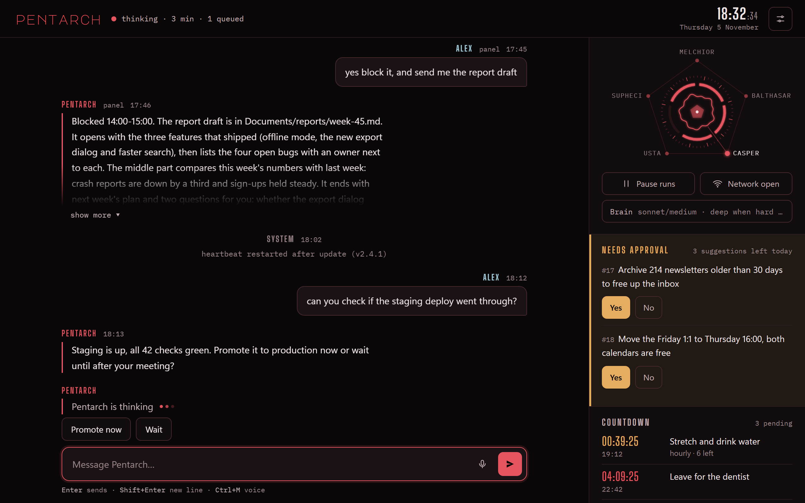

<p align="center"></p>

# Pentarch

A personal assistant that lives on your Windows computer and talks to you over Telegram. It runs on the AI agent you already use (Claude Code, Gemini CLI, Codex or OpenCode), remembers what you told it, runs its own routines through the day and asks before it does anything you can't take back.

[Türkçe](#türkçe)



## What it does

- **Telegram chat.** Text, photos, voice notes, buttons. With Claude Code the chat stays in one long-lived session all day, so replies are fast and cheap. Hard questions switch to a deeper model on their own.
- **Panel.** A local status page (`http://127.0.0.1:47824`) with the chat, health, spending, reminders, the job board, proposals waiting for a yes, and every setting. It works on a phone-sized window too.
- **Memory.** Your profile, a memory page the nightly round keeps tidy, a rules file, and fast full-text search over your notes and past chats. Optional semantic search through a local Ollama model.
- **Routines.** Morning brief, evening summary, a heartbeat checklist, reply checks for messages you're waiting on, news in your field, a weekly retro of what went wrong, and a weekly look for new tools.
- **Reminders and tasks.** "Remind me at 10" or "do this tonight" become entries that fire on time. A task runs in its own agent session, with a daily budget cap.
- **Proposals.** When a routine finds work that would help you, it suggests it with Yes/No buttons. Nothing outward (sending, pushing, deleting) happens without your yes.
- **Council.** `council: question` asks several models at once. They answer, read each other, argue a second round and vote.
- **Career.** Watches open hackathons and remote junior jobs (Devpost, Remotive, Greenhouse and Lever boards you pick), tracks your GitHub PRs, and a small offline dashboard for applications and a learning plan (`tracker/`).
- **Notifications (optional).** Reads Windows notifications from apps you choose; a cheap model filters out the noise.
- **Voice.** Voice notes become text locally (faster-whisper); it can answer with voice (edge-tts, or Piper offline).
- **Data quota mode (optional).** On a metered connection it spreads the monthly cap over the days left and holds heavy jobs back.

## Install

You need Windows 10/11, Python 3.10+, a Telegram account, and one agent CLI installed and logged in. Claude Code gets every feature. Gemini CLI, Codex and OpenCode keep the Telegram chat in one session per day too, but skip the budget and safety hooks that only Claude Code has. With OpenCode, `--continue` picks up the notes folder's latest session, so a routine that ran there in between can become the one it continues.

```bash
git clone https://github.com/<you>/pentarch.git
cd pentarch
python setup.py
```

Setup asks for your name, the assistant's name, the language (English or Turkish; the setup itself switches too), your notes folder, which agent CLI and models to use, and your Telegram bot token (make a bot with @BotFather, `/newbot`). It checks each connection as you go: it sends the agent a one-word test so a missing login shows up now, asks Telegram who the bot is, and lists the models an optional API answers with. For that API you pick OpenRouter, Groq, Ollama, LM Studio or your own URL; it tells you where to get a key and keeps it in `~/.pentarch/secrets/keys.env`. Everything goes to `~/.pentarch`, never to the repo, and it adds a startup shortcut.

Start it once by hand, then send any message to your bot. The first chat that writes becomes the owner; messages from anyone else are ignored.

```bash
python -I app/pentarch.py
```

## Configure

`~/.pentarch/pentarch.json` holds the settings; anything you leave out falls back to the defaults in [`app/config.py`](app/config.py). Re-running `python setup.py` is safe and keeps your memory files. The ones you'll most likely touch:

| Key | What it does |
|---|---|
| `agent.cli`, `fast_model`, `deep_model`, `light_model` | Which agent and models do the work |
| `agent.permission_mode` | `acceptEdits` (safer) or `bypassPermissions` (most routines need it) |
| `chat_api` | Any OpenAI-compatible endpoint for cheap one-shot work: OpenRouter, Groq, Ollama, LM Studio. The key comes from the env var named in `key_env` or `~/.pentarch/secrets/keys.env` |
| `council` | Seats for the council. Add them with `python -I app/koltuk.py add NAME --preset openrouter\|groq\|nvidia\|ollama\|lmstudio` (or `--agent`), or tell the bot "add a seat to the council". Each seat is `{"name", "kind": "agent"\|"openai", "model", "base_url", "key_env", "role"}`; `"model": "a,b"` tries `b` when `a` is rate-limited (OpenRouter) |
| `notify_apps` | Windows notification app id → label, e.g. `{"com.squirrel.Teams.Teams": "Teams"}` |
| `jobs_off` | Routines that start switched off: `insa` (nightly self-build) and `posta` (mail check). Setup asks about both, and the panel's Settings turns any routine on or off later |
| `opportunities`, `job_boards` | Filters for the hackathon/job watch; see the top of `app/firsat.py` and `app/kariyer.py` |
| `github_user` | Turns on PR tracking (needs `gh`) |
| `net_quota_gb` | Monthly data cap; 0 turns quota mode off |
| `desktop_control`, `voice_replies`, `auto_reply` | Off/on switches for the riskier extras |

The prompts are plain markdown in `~/.pentarch`: `kurallar.md` (rules), `profile.md` (who you are, what it may do without asking), `memory.md`, `HEARTBEAT.md`, `wishlist.md`. Edit them; they're yours.

## Telegram commands

| Say | Does |
|---|---|
| anything | Chat |
| `cancel` / `iptal` | Stops the current run |
| `pause 2h` / `resume` | Pauses automatic messages |
| `council: question` | Convenes the council |
| `key: ENV_NAME=value` | Stores an API key in `secrets/keys.env` and deletes the message; it is never logged or shown to the model |
| `test` | Runs the end-to-end tests |
| `internet` / `internet free` / `internet limited` | Quota mode status and switch |

From a shell (the agent uses these too): `python -I app/pentarch.py remind "2026-12-01 10:00" "text"`, `task now "job"`, `wait "where" "what"`, `search "word"`.

## Safety

- Secrets live in `~/.pentarch/secrets` and are never written into prompts, logs or the repo.
- Scheduled runs get a read-only hook (`app/salt_okunur.py`) that blocks mail sending, calendar writes and similar outward tools.
- The panel only answers on `127.0.0.1`, with a per-start secret header.
- Text found in mail, web pages or files is treated as data, never as an instruction or a permission.
- Before text goes to an API model (`chat_api` or an `openai` council seat), the values in `keys.env` and common key shapes (OpenAI/OpenRouter `sk-`, Groq, NVIDIA, GitHub, Google, AWS, Slack, Telegram bot tokens) are replaced with `[secret]`. The agent CLI gets your text as it is.

### Where it connects

Nothing leaves your machine except these:

| Where | Why |
|---|---|
| `api.telegram.org` | your chat with the bot, plus a health check |
| your agent CLI's own service | whatever Claude Code, Gemini CLI, Codex or OpenCode talk to |
| `chat_api` and council seat URLs | only the ones you set; none by default |
| `speech.platform.bing.com` (edge-tts) | voice answers to voice messages (`voice_replies`; Piper runs locally if it is offline) |
| `boards-api.greenhouse.io`, `api.lever.co` | job tracker, only for the companies you list |
| `remotive.com`, `devpost.com` | the opportunities routine |
| `health_urls` | extra addresses you ask it to watch |

Local only: the panel on `127.0.0.1` and Ollama on `127.0.0.1:11434` for memory search, if you run it.

## Notes

Some internal names are Turkish (job names like `sabah`, files like `kurallar.md`). The project started in Turkish and renaming every file would break existing installs. Everything you see as a user follows your language setting.

MIT license. Fonts in `app/fonts` are under the SIL Open Font License.

---

## Türkçe

Pentarch, Windows bilgisayarında yaşayan ve seninle Telegram'dan konuşan kişisel bir asistan. Zaten kullandığın AI ajanıyla çalışır (Claude Code, Gemini CLI, Codex ya da OpenCode). Ona söylediklerini hatırlar, gün boyu kendi rutinlerini koşar, geri alınamayacak bir şey yapmadan önce sorar.

**Neler yapıyor:** Telegram'dan yazı, foto, sesli mesaj ve butonla sohbet; yerel panel; hafıza ve not araması; sabah özeti, akşam özeti, haftalık retro gibi rutinler; hatırlatma ve ileri tarihli görevler; Evet/Hayır butonlu öneriler; birkaç modelin tartışıp oy verdiği konsey; hackathon ve junior iş takibi, PR takibi, başvuru panosu (`tracker/`); isteğe bağlı bildirim süzgeci, sesli cevap ve kotalı internet modu.

**Kurulum:** Windows 10/11, Python 3.10+, bir Telegram hesabı ve kurulu, giriş yapılmış bir ajan CLI'ı lazım.

```bash
git clone https://github.com/<sen>/pentarch.git
cd pentarch
python setup.py
```

Kurulum adını, asistanın adını, dili (Türkçe ya da İngilizce; seçince kurulum da o dile geçer), not klasörünü, ajanı ve modelleri, Telegram bot token'ını sorar (@BotFather'da `/newbot`). Bağlantıları hemen dener: ajana tek kelimelik bir mesaj atar, Telegram'a botun adını sorar, isteğe bağlı API'nin model listesini çeker. API için OpenRouter, Groq, Ollama, LM Studio ya da kendi adresini seçersin; anahtarı nereden alacağını söyler ve `~/.pentarch/secrets/keys.env` içine yazar. `insa` ve `posta` rutinleri kapalı başlar; kurulumda ya da sonra panelin Ayarlar kısmından açabilirsin. Her şeyi `~/.pentarch` içine yazar, repoya hiçbir şey yazmaz, başlangıca kısayol ekler. Sonra `python -I app/pentarch.py` ile bir kez başlat ve botuna herhangi bir mesaj at: ilk yazan sohbet sahip olur.

**Ayarlar:** `~/.pentarch/pentarch.json`. Yazmadığın her şey [`app/config.py`](app/config.py) içindeki varsayılana düşer. Komutlar ve ayar anahtarları yukarıdaki İngilizce tablolarda; Türkçe karşılıkları da çalışır (`iptal`, `durdur 2 saat`, `konsey: soru`, `internet serbest`).

**Konsey koltukları:** `python -I app/koltuk.py add AD --preset openrouter` (ya da `groq`, `nvidia`, `ollama`, `lmstudio`, `custom`, `--agent`), `list`, `test AD`, `remove AD`. Bota "konseye koltuk ekle" demek de yeter. Anahtarı sohbete yazma; `koltuk.py key DEGISKEN` ile ya da bota `anahtar: DEGISKEN=değer` mesajıyla ver, bot kaydedip mesajı siler.

**Güvenlik:** API modeline (`chat_api` ya da `openai` konsey koltuğu) giden metindeki `keys.env` değerleri ve bilinen anahtar biçimleri `[secret]` ile değiştirilir; ajan CLI'ına metin olduğu gibi gider. Makineden dışarı nereye bağlandığı yukarıdaki "Where it connects" tablosunda.
